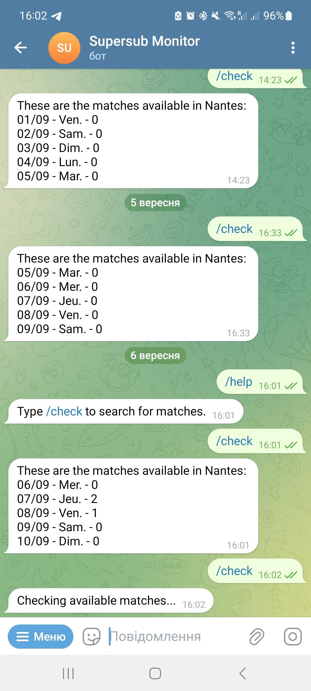

# Supersub Monitor

An application that reports available matches for an UrbanSoccer Supersub to a Telegram bot.



## Table of Contents

- [Introduction](#introduction)
- [Features](#features)
- [Deployment](#deployment)
- [Development](#development)
- [Dependency updates](#dependency-updates)
- [Contributing](#contributing)
- [License](#license)

## Introduction

In France, there is a network of football fields called UrbanSoccer. This network has a web portal, where among other possibilities there is a feature of matching players without a team with teams in need of substitutes — it's called Supersub.

I felt the need to receive the reports about available matches easier and quicker compared to visiting the web portal, and that's how this application appeared.

## Features

* Built with Python
* Scrapes the UrbanSoccer web portal using Selenium and ChromeDriver
* Automatically gets latest ChromeDriver using webdriver-manager
* Integration with Telegram powered by python-telegram-bot
* Continuous Deployment implemented with GitHub Actions
* Deployed on Google Cloud Platform, on a free tier Compute Engine VM
* Wrapped in systemd service

## Deployment

1. Provision a Virtual Machine
2. Clone the repository onto the host:
    ```
    sudo git clone https://github.com/F1orin/supersub_monitor.git /opt/supersub_monitor
    cd /opt/supersub_monitor
    ```
3. Create python's virtual environment:
    ```
    python3 -m venv .venv
    source .venv/bin/activate
    ```
4. Install dependencies:
    ```
    pip install --upgrade pip
    pip install -r requirements.txt
    ```
5. Populate the required environment variables:
    ```
    cp src/.env.template src/.env
    nano src/.env
    ```
    1. Set the city (e.g. `Nantes`)
    2. Provide UrbanSoccer credentials (Browser dev tools -> Application -> Local storage, look for `auth-token` and `auth-userid`)
    3. Configure Telegram bot - see [here](https://telegram.me/BotFather)
6. Install and start the supersub systemd service.
    ```
    sudo cp deploy/supersub.service /etc/systemd/system/supersub.service
    sudo systemctl daemon-reload
    sudo systemctl enable --now supersub
    ```

Tip: rebooting the GCE instance changes its public IP, so remember to update the SSH_HOST secret in GitHub Actions before the next deploy.

Production installs the generated `requirements.txt`; it does not need pip-tools or the development requirements.

## Development

Use Python 3.11 to match CI:

```bash
python3.11 -m venv .venv
source .venv/bin/activate
python -m pip install -r requirements-dev.txt
python -m pytest
```

`requirements-dev.txt` includes the runtime dependencies and pytest. CI installs this file before running the tests.

## Dependency updates

Maintain direct runtime dependencies in `requirements.in` and test dependencies in `requirements-dev.in`. The `job-queue` extra on python-telegram-bot installs the scheduler needed for recurring notifications.

`requirements.txt` and `requirements-dev.txt` are generated by pip-tools and contain exact versions of all required dependencies. Development requirements are constrained by the runtime pins so both environments use the same runtime versions. Commit all four files and regenerate the `.txt` files instead of editing them by hand.

Generate the files using Python 3.11, matching CI, and the same operating system as the deployment when resolving platform-specific dependencies. Check the production virtual environment's Python version with `.venv/bin/python --version` before changing the target Python version. Compile and test separately if supporting additional Python versions or platforms, since resolution can differ.

Install the generation tool in your development environment:

```bash
python -m pip install pip-tools==7.6.2
```

After editing either `.in` file, regenerate the runtime file first:

```bash
pip-compile requirements.in
pip-compile requirements-dev.in
```

Existing pins are retained when they still satisfy the inputs. To update a direct dependency, change its version in the `.in` file and regenerate both files. To update an indirect dependency, request it explicitly, for example:

```bash
pip-compile --upgrade-package certifi requirements.in
pip-compile requirements-dev.in
```

Then install and validate the generated development requirements:

```bash
python -m pip install -r requirements-dev.txt
python -m pip check
python -m pytest
```

Dependabot continues checking the pip requirements weekly. Review updates to the input and generated files together.

Installing with pip does not uninstall packages removed from requirements. To verify a minimal environment after removing dependencies, create a fresh virtual environment and install the appropriate generated file. Existing production environments may retain old unused packages until their virtual environment is recreated.

## Contributing

If you would like to contribute, please submit a pull request.

## License

This project is licensed under the [MIT License](LICENSE).
